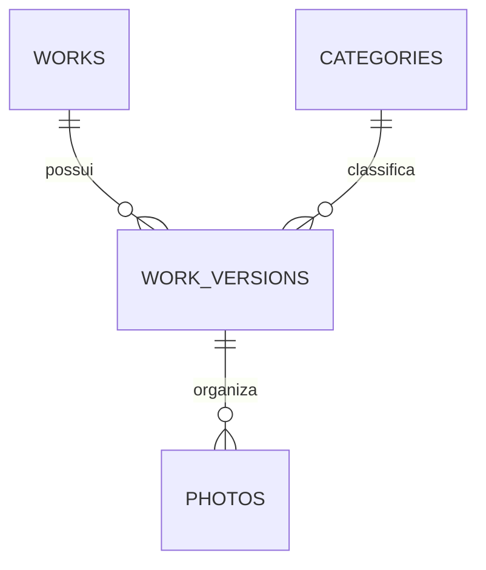

# Etapa 4 — estrutura do banco e permissões

A estrutura é preparada para Supabase/PostgreSQL e testada localmente. A interface continua usando os dados locais da galeria. Não há projeto remoto vinculado, credenciais, migração remota ou publicação na Vercel.

## Modelo

| Tabela                   | Responsabilidade                                                                 |
| ------------------------ | -------------------------------------------------------------------------------- |
| `public.categories`      | Categorias, descrições públicas e ordem                                          |
| `public.works`           | Identidade e endereço do trabalho; aponta para a versão publicada                |
| `public.work_versions`   | Conteúdo, categoria, capa, revisão e data de selagem                             |
| `public.photos`          | Arquivo, descrição acessível, dimensões, ordem, enquadramento e estado do upload |
| `public.site_settings`   | Uma linha com marca, região, contatos e fotos institucionais públicas            |
| `private.administrators` | Contas autorizadas a administrar, vinculadas a `auth.users`                      |



`administrators` fica em um schema privado, fora dos schemas expostos pela API. Não contém senha ou cópia do perfil; somente a identificação da conta gerenciada pelo Auth.

## Rascunho e publicação

Um trabalho pode ter somente um rascunho com `sealed_at` nulo. Versões já publicadas ficam seladas e imutáveis. O campo `works.published_version_id` determina qual delas está visível. As anteriores são preservadas, mas deixam de aparecer na galeria.

Editar exige um novo rascunho. A criação e a cópia desse rascunho serão integradas ao painel na etapa de edição. As fotos podem reutilizar um mesmo caminho imutável de arquivo entre versões.

As chaves estrangeiras compostas garantem que a capa pertença à sua versão e que a versão publicada pertença ao seu trabalho. A ordem das fotos é única por versão; uma transação pode adiar a verificação para trocar posições e validá-las ao final. Categorias referenciadas não podem ser excluídas.

As versões seladas também não podem ser excluídas nesta etapa. Como sua categoria é imutável, uma categoria utilizada no histórico deve ser preservada. A futura gestão de categorias deverá considerar esse histórico e definir uma operação de arquivamento ou migração controlada, em vez de apagar a categoria diretamente.

## Publicação transacional

`publish_work(work_id, version_id, expected_revision)`:

1. Confere a conta na lista de administradores.
2. Bloqueia a versão e o trabalho durante a operação.
3. Confere a revisão esperada, o título, a capa e todas as fotos.
4. Confere existência, MIME e tamanho dos arquivos nos metadados do Storage.
5. Sela a versão e troca o apontamento público na mesma transação.

Qualquer erro desfaz a operação e preserva a publicação anterior. Repetir uma publicação que já terminou retorna a mesma versão. Uma versão antiga selada não pode ser republicada diretamente; a recuperação editorial será feita por novo rascunho.

`unpublish_work(work_id, expected_version_id)` retira o trabalho da galeria sem apagar o histórico. A versão esperada evita retirar uma publicação que já foi substituída por outra pessoa.

`revision` aumenta quando metadados ou fotos mudam. A publicação rejeita uma revisão desatualizada. A edição futura deverá usar atualização condicional por revisão ou RPC de salvamento; o simples `UPDATE` de um rascunho, sem essa condição, ainda pode sobrescrever uma edição concorrente. A interface de edição e sua transação de salvamento não estão implementadas nesta entrega.

## Matriz de acesso

| Operação                                                 | Visitante | Conta comum | Administrador |
| -------------------------------------------------------- | --------- | ----------- | ------------- |
| Ler categorias e configurações públicas                  | Sim       | Sim         | Sim           |
| Ler trabalhos e versões publicados                       | Sim       | Sim         | Sim           |
| Ler rascunhos e histórico                                | Não       | Não         | Sim           |
| Editar conteúdo de rascunhos                             | Não       | Não         | Sim           |
| Editar versão selada                                     | Não       | Não         | Não           |
| Publicar ou retirar trabalho pela função                 | Não       | Não         | Sim           |
| Alterar diretamente ponteiro público, revisão ou selagem | Não       | Não         | Não           |
| Conceder acesso administrativo pela aplicação            | Não       | Não         | Não           |

As permissões de tabela e coluna limitam as operações; RLS limita as linhas. Funções privilegiadas usam `search_path` fixo e autorização explícita. Não se confia em metadados editáveis do usuário para reconhecer administradores.

O primeiro administrador deverá ser uma conta existente criada pelo fluxo confiável do Supabase Auth. Um operador confiável poderá inserir seu UUID em `private.administrators` por conexão administrativa. A aplicação não recebe permissão para isso. O seed não cria contas nem administradores.

## Arquivos

O bucket `portfolio` é privado, aceita JPEG, PNG e WebP e tem limite de 10 MiB por arquivo. HEIC e SVG não são aceitos por este fluxo. Caminhos usam duas partes no formato UUID e a extensão, evitando nomes de clientes ou informação pessoal.

O visitante só recebe acesso de leitura aos objetos associados a fotos publicadas. Administradores podem ler e enviar novos arquivos. Sobrescrita e exclusão física estão bloqueadas para os papéis da aplicação, inclusive se outra política permissiva de Storage for criada. A limpeza segura de arquivos será uma etapa própria, com conferência de referências e execução por serviço confiável.

Os bytes devem ser enviados e removidos pela API Storage. Não se deve inserir ou excluir linhas em `storage.objects` manualmente no Supabase real. Os testes fazem isso somente no contrato simulado, que não contém arquivos reais.

O estado `ready` exige descrição e dimensões. A publicação também verifica o objeto no Storage; marcar `ready` sozinho não basta. As dimensões e o conteúdo real dos bytes ainda precisarão de validação no fluxo de upload. Um upload falho pode deixar um arquivo órfão; sua limpeza não é executada por estas migrações.

A futura integração exibirá fotos com URLs assinadas. Sua duração e renovação deverão ser configuradas nessa integração. Retirar um trabalho impede novas leituras autorizadas, mas não revoga automaticamente URLs já emitidas antes de expirarem.

## Fotos institucionais

`hero_photo_id` e `portrait_photo_id` só aceitam fotos prontas de uma versão selada. Referenciar uma foto nessas configurações é uma publicação explícita e independente da galeria. Ela continua disponível se o trabalho for retirado; para retirar também a foto institucional, é necessário limpar sua referência. As outras fotos e os metadados da versão arquivada continuam privados.

## Testes executáveis sem serviços externos

```sh
npm ci
npm run test:db
npm run check
```

PGlite 0.5.15 executa PostgreSQL 18.6 em memória, somente como dependência de desenvolvimento. Cada teste usa uma transação descartada ao final. O runner aplica as migrações reais em ordem e executa o seed duas vezes para conferir repetibilidade.

`tests/fixtures/supabase-contract.sql` simula `auth.uid()`, os papéis e os metadados de Storage. Esse arquivo não pode ser aplicado a um projeto Supabase. Os testes verificam SQL, RLS, permissões, integridade, revisão, publicação, retirada, idempotência e proteção de arquivos.

Os testes não validam o serviço Auth, JWT real, PostgREST, Storage HTTP, bytes, URLs assinadas nem operações simultâneas em múltiplas conexões. PGlite utiliza uma conexão; o Supabase local está configurado para PostgreSQL 17. A validação na versão real e com serviços completos continua necessária.

## Supabase local completo — pendente

Docker, Supabase CLI e `psql` não estavam disponíveis no terminal durante a preparação. O `supabase/config.toml` está preparado, mas ainda não foi executado pela CLI. A instalação e a inicialização desses serviços ficam para a preparação do ambiente de integração.

Depois de instalar e validar os pré-requisitos, na raiz do projeto:

```sh
supabase start
```

Para reconstruir apenas um banco local descartável:

```sh
supabase db reset --local
```

O reset apaga os dados do banco local antes de reaplicar migrações e seed. Não usar sobre dados que precisam ser preservados. Não é necessário `supabase login`, `supabase link` ou comando remoto para o desenvolvimento local.

Portas configuradas: API 54321, banco 54322, Studio 54323 e shadow database 54320. A aplicação Vite permanece em 5173. Não encaminhar essas portas à internet. O cadastro público está desativado.

Antes de integrar o login, repetir a matriz de acesso pela API real, conferir uploads e links assinados e testar edições/publicações concorrentes em conexões independentes. O seed contém apenas categorias, configurações fictícias e um rascunho sem fotos.

## Evolução e recuperação

Após uma migração ser aplicada e compartilhada, alterações devem ser feitas em uma nova migração. Para esta fundação ainda não aplicada remotamente, a reconstrução local é reproduzível pelo reset. Em ambiente com dados, não usar reset nem assumir que reverter o código desfaz o banco: preparar migração corretiva ou restauração de backup e considerar também os arquivos do Storage.

## Referências

- [RLS no Supabase](https://supabase.com/docs/guides/database/postgres/row-level-security)
- [Funções e privilégios](https://supabase.com/docs/guides/database/functions)
- [Migrações locais](https://supabase.com/docs/guides/local-development/database-migrations)
- [Controle de acesso do Storage](https://supabase.com/docs/guides/storage/security/access-control)
- [Schema do Storage](https://supabase.com/docs/guides/storage/schema/design)
- [PGlite](https://pglite.dev/docs/api)
